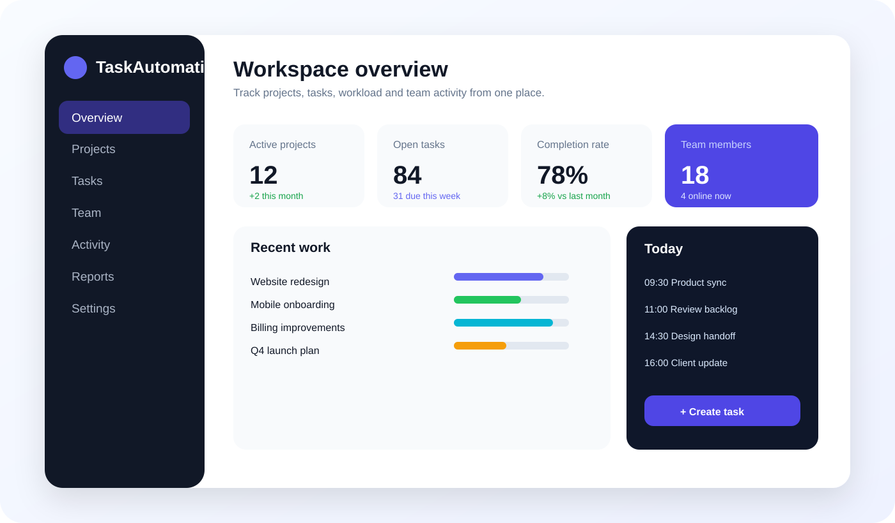
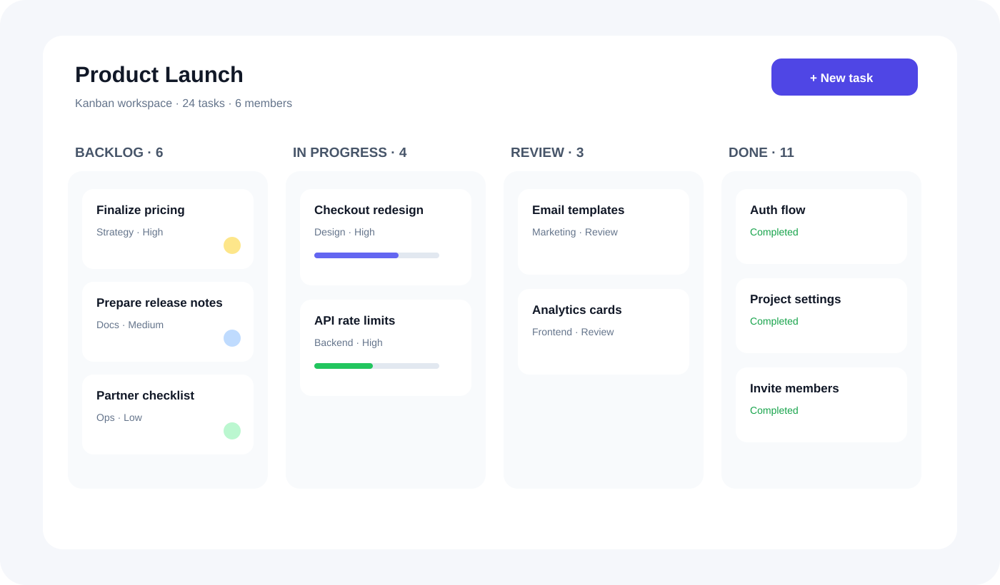
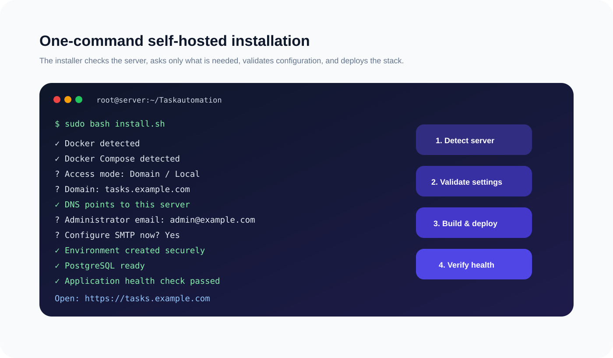

# TaskAutomation

<p align="center">
  <strong>A self-hosted project management and team collaboration platform designed for simple VPS deployment.</strong>
</p>

<p align="center">
  Django · React · TypeScript · PostgreSQL · Docker Compose · Caddy
</p>

<p align="center">
  <a href="#installation">Installation</a> ·
  <a href="#deployment-modes">Deployment</a> ·
  <a href="#current-status">Current Status</a> ·
  <a href="#product-roadmap">Roadmap</a>
</p>

---

## Overview

TaskAutomation is being built as an open, self-hosted alternative for teams that want to manage projects, tasks, members, progress, collaboration, and reporting on infrastructure they control.

The main deployment goal is simple:

```text
Clone repository
      ↓
Run one installer
      ↓
Answer a few setup questions
      ↓
Server is validated automatically
      ↓
Application is built and deployed
      ↓
Open TaskAutomation in the browser
```

Users should not need to manually install Python, Node.js, PostgreSQL, Gunicorn, or frontend dependencies. The installer and Docker stack handle the application environment.

---

## Product UI Direction

> **Note:** The images below are product UI concepts showing the intended interface direction. They are not screenshots of fully implemented features yet.

### Workspace Dashboard



A central workspace for project status, open tasks, team activity, completion rates, schedules, and recent work.

### Project & Task Board



Planned project views include Kanban boards, list views, task ownership, priorities, status workflows, progress tracking, and team collaboration.

### Guided Server Installation



The installer is designed to make self-hosting closer to a guided product installation than a manual DevOps process.

---

## Current Status

TaskAutomation currently provides the deployment foundation for the product.

### Working today

- Django backend
- Django REST Framework
- React + TypeScript + Vite frontend
- PostgreSQL database
- Docker Compose deployment
- Gunicorn application server
- WhiteNoise static-file serving
- Automatic database migrations
- Automatic initial administrator creation
- SMTP configuration support
- Environment generation through the installer
- Local/server-IP deployment mode
- Domain deployment mode
- DNS validation before domain installation
- Caddy reverse proxy for automatic HTTPS
- Docker and Docker Compose detection
- Automatic Docker/Compose installation on supported Ubuntu/Debian systems
- Port conflict detection
- PostgreSQL credential synchronization when reconfiguring an existing installation
- Application health endpoint

### Product features being built next

- User authentication and onboarding
- Organizations and workspaces
- Teams and member management
- Projects
- Tasks and subtasks
- Assignees
- Priorities
- Custom statuses
- Kanban board
- Task list view
- Due dates and milestones
- Comments
- File attachments
- Activity history
- Notifications
- Time tracking
- Team workload
- Dashboards
- Reports
- Project settings
- Workspace administration

---

## Technology Stack

| Layer | Technology |
|---|---|
| Backend | Django + Django REST Framework |
| Frontend | React + TypeScript + Vite |
| Database | PostgreSQL |
| Application Server | Gunicorn |
| Static Files | WhiteNoise |
| Containers | Docker + Docker Compose |
| HTTPS / Reverse Proxy | Caddy |
| Configuration | Installer-generated `.env` |

The frontend and backend live in the same repository and are deployed together. Vite builds the React frontend during the Docker image build, and Django serves the resulting application through the same deployment.

---

## Installation

### Recommended installation

On a fresh Ubuntu/Debian VPS:

```bash
git clone https://github.com/pushpinder6805/Taskautomation.git
cd Taskautomation
sudo bash install.sh
```

That is the normal installation command.

You should **not** need to manually create `.env`, install PostgreSQL, install Node.js, install Python packages, or run migrations yourself.

### What the installer does

The installer:

1. Detects the Linux distribution.
2. Checks whether required system utilities are available.
3. Checks whether Docker is installed.
4. Installs Docker when required on supported systems.
5. Checks for Docker Compose v2.
6. Installs Docker Compose when required.
7. Detects an existing TaskAutomation configuration.
8. Lets the user keep or reconfigure the existing installation.
9. Asks whether TaskAutomation should use a domain or local/server-IP mode.
10. Validates the selected port.
11. Validates domain DNS before domain deployment.
12. Detects conflicts on ports 80 and 443 for domain installations.
13. Collects administrator details.
14. Optionally collects SMTP configuration.
15. Generates secure Django and PostgreSQL secrets.
16. Creates `.env` automatically with restricted permissions.
17. Synchronizes PostgreSQL credentials when using an existing database volume.
18. Builds the frontend and backend Docker image.
19. Starts PostgreSQL.
20. Runs Django migrations.
21. Creates the initial administrator account.
22. Starts Gunicorn.
23. Starts Caddy in domain mode.
24. Performs an application health check.
25. Displays the final application URL.

---

## Deployment Modes

### 1. Domain + automatic HTTPS

Recommended for production.

During installation choose:

```text
1) Domain with automatic HTTPS
```

Example:

```text
tasks.example.com
```

Before installation continues, TaskAutomation checks that the domain resolves to the current server's public IPv4 address.

Example DNS configuration:

```text
Type: A
Host: tasks
Value: YOUR_SERVER_PUBLIC_IP
```

Domain mode uses Caddy to handle:

```text
Internet
   ↓
Ports 80 / 443
   ↓
Caddy
   ↓
TaskAutomation
```

Caddy automatically requests and renews HTTPS certificates.

### 2. Local / server-IP mode

Useful for testing or internal environments.

During installation choose:

```text
2) Local/server IP with a port
```

The installer searches for an available port starting at `8080`.

Example:

```text
http://203.0.113.20:8080
```

---

## Configuration

The installer creates `.env` automatically.

Typical values include:

```env
APP_NAME=TaskAutomation
DEBUG=false
SECRET_KEY=generated-automatically
ALLOWED_HOSTS=your-domain.example
DOMAIN=your-domain.example
SITE_URL=https://your-domain.example
APP_BIND=127.0.0.1:18080

POSTGRES_DB=taskautomation
POSTGRES_USER=taskautomation
POSTGRES_PASSWORD=generated-automatically
POSTGRES_HOST=db
POSTGRES_PORT=5432

ADMIN_EMAIL=admin@example.com
ADMIN_PASSWORD=your-selected-password
ADMIN_NAME=Administrator

SMTP_HOST=smtp.example.com
SMTP_PORT=587
SMTP_USER=your-smtp-user
SMTP_PASSWORD=your-smtp-password
SMTP_USE_TLS=true
DEFAULT_FROM_EMAIL=noreply@example.com
```

Do not commit the generated `.env` file.

---

## Updating

Pull the latest code and run the installer again:

```bash
cd ~/Taskautomation
git pull
sudo bash install.sh
```

If `.env` already exists, the installer asks:

```text
An existing .env configuration was found. Reconfigure it? [y/N]:
```

Choose `n` to keep the current settings or `y` to run the setup questions again.

Running only:

```bash
docker compose down
```

does **not** remove `.env` or the PostgreSQL volume.

---

## Completely Reconfigure an Installation

To keep your database but recreate the installation configuration:

```bash
sudo bash install.sh
```

Then choose `y` when asked whether to reconfigure.

For a truly fresh development installation where existing data is not required, Docker volumes can also be removed manually. Do not remove volumes on a production server unless the stored database data is intentionally being deleted.

---

## Health Check

TaskAutomation exposes:

```text
GET /api/health/
```

Local example:

```bash
curl http://127.0.0.1:8080/api/health/
```

Expected response:

```json
{"status":"ok"}
```

---

## Useful Commands

### Container status

```bash
docker compose ps
```

### Application logs

```bash
docker compose logs --tail=100 app
```

### Follow all logs

```bash
docker compose logs -f
```

### Rebuild

```bash
docker compose up -d --build
```

### Stop containers

```bash
docker compose down
```

---

## Troubleshooting

### Application keeps restarting

Check:

```bash
docker compose ps
docker compose logs --tail=100 app
```

A healthy application container should remain `Up`; it should not repeatedly show `Restarting`.

### Port already allocated

Check what is using the port:

```bash
ss -ltnp
```

Domain mode requires ports `80` and `443` for automatic HTTPS.

### Domain validation fails

Confirm the domain's A record points to the public IP of the VPS. The installer intentionally stops if DNS does not match the server.

### Browser cannot connect in local mode

Confirm the application is listening:

```bash
ss -ltnp | grep 8080
```

Also verify the VPS provider's firewall/security-group rules allow the configured port.

---

## Repository Layout

```text
Taskautomation/
├── backend/
│   ├── config/
│   ├── core/
│   └── manage.py
├── frontend/
│   ├── src/
│   ├── index.html
│   ├── package.json
│   └── vite.config.ts
├── docs/
│   └── images/
├── Caddyfile
├── Dockerfile
├── docker-compose.yml
├── entrypoint.sh
├── install.sh
├── .env.example
└── README.md
```

---

## Deployment Architecture

```text
                 Domain mode

                Internet
                   │
             HTTPS :443
                   │
                 Caddy
                   │
              Django API
                   │
              PostgreSQL
                   │
               Docker

React/Vite frontend ── built into the application image
```

In local mode, the application can instead expose a selected host port such as `8080` directly.

---

## Product Roadmap

### Phase 1 — Foundation

- [x] Monorepo architecture
- [x] Django backend
- [x] React frontend
- [x] PostgreSQL
- [x] Docker Compose
- [x] Guided installer
- [x] Domain validation
- [x] Automatic HTTPS foundation
- [x] Admin bootstrap
- [x] Health checks

### Phase 2 — Core Project Management

- [ ] Authentication UI
- [ ] Workspaces
- [ ] Members and roles
- [ ] Projects
- [ ] Tasks
- [ ] Subtasks
- [ ] Assignees
- [ ] Priorities
- [ ] Status workflows
- [ ] Kanban board
- [ ] List view

### Phase 3 — Collaboration

- [ ] Comments
- [ ] Attachments
- [ ] Mentions
- [ ] Notifications
- [ ] Activity history
- [ ] Email notifications

### Phase 4 — Planning & Reporting

- [ ] Time tracking
- [ ] Team workload
- [ ] Milestones
- [ ] Dashboards
- [ ] Reports
- [ ] Productivity analytics

### Phase 5 — Self-hosting Experience

- [ ] Web-based setup wizard
- [ ] Backup and restore tools
- [ ] Built-in update workflow
- [ ] Server health dashboard
- [ ] SMTP test during setup
- [ ] Automated upgrade checks

---

## Project Goal

TaskAutomation aims to combine a modern project-management experience with a self-hosting process simple enough that a user can deploy it to a normal VPS without manually configuring the application stack.

The intended experience is:

```text
Download → Install → Configure → Use
```

with the infrastructure details handled by the application wherever practical.

---

## Repository

https://github.com/pushpinder6805/Taskautomation
